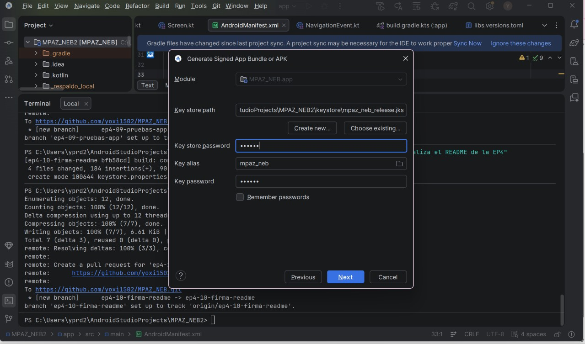
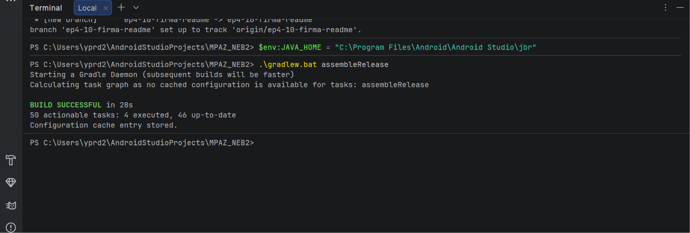

# MPAZ NEB

Aplicación móvil Android de apoyo y nivelación en **Lectura** y **Matemática** para estudiantes de 1.º a 4.º básico de la Escuela Escritora Marcela Paz (San Bernardo). Es un MVP académico que usa **solo datos ficticios**.

> Asignatura: Desarrollo de Aplicaciones Móviles (DSY1105) · Duoc UC · Evaluación Parcial 4

La app está hecha en **Kotlin con Jetpack Compose (MVVM)** y se conecta a **3 microservicios propios en Spring Boot** y a **2 APIs externas** (PokeAPI y JSONPlaceholder).

## 1. Nombre del proyecto

**MPAZ NEB**: apoyo a la nivelación en Lectura y Matemática.

## 2. Integrantes

**Equipo N.º:** 2

| Integrante | Usuario GitHub | Responsabilidades principales |
|---|---|---|
| Maximiliano Valenzuela | `maxijrr20` | Arquitectura y paquetes, tema Material 3, historial de resultados. EP4: microservicios `ms-actividades` y `ms-sesiones`, capa remota con Retrofit y premio con PokeAPI |
| Genesis Cerda | `gene1921` | Módulos de Lectura y Matemática, cámara, texto a voz y animaciones. EP4: catálogo conectado a `ms-actividades`, sesiones e historial con `ms-sesiones`, microservicio `ms-usuarios` |
| Yoximar Ruiz | `yoxi1502` | Panel docente, sesiones con código, login con perfiles, catálogo (UTP) y documentación. EP4: login contra `ms-usuarios`, pruebas unitarias con MockK, firma del APK y README |

## Problema que resuelve

Las asistentes de aula preparan a mano guías de refuerzo repartidas en distintos documentos y no hay un registro central de qué actividad hizo cada estudiante ni cuántos intentos necesitó. MPAZ NEB centraliza actividades de Lectura y Matemática organizadas por curso y dificultad, permite asignarlas a un estudiante ficticio con un código temporal y registra respuestas, intentos y resultados básicos en un servidor.

La app es una herramienta de apoyo: **no diagnostica, no califica oficialmente y no reemplaza el criterio de docentes, UTP o PIE**.

## 3. Funcionalidades

| Perfil | Qué puede hacer |
|---|---|
| **Docente / UTP** | Todo lo de la asistente + catálogo de actividades: filtrar, crear, editar, activar/desactivar y eliminar |
| **Asistente de aula** | Asignar una actividad *Disponible* a un estudiante, generar el código, acompañar la sesión, registrar observaciones, ver y editar el historial |
| **Estudiante** | Entrar solo con el código de su sesión, responder, recibir retroalimentación, escuchar textos en voz alta y recibir un Pokémon compañero |

- **Login contra `ms-usuarios`**: la contraseña se verifica en el servidor con BCrypt. El usuario queda recordado en el dispositivo (DataStore) y las rutas del equipo pedagógico están protegidas por perfil.
- **Catálogo CRUD contra `ms-actividades`**: listar (GET), crear (POST), editar (PUT), activar/desactivar (PATCH) y eliminar con confirmación (DELETE).
- **Sesiones contra `ms-sesiones`**: el servidor genera el código `MPAZ-XXXXXX` y no permite dos sesiones abiertas para la misma asistente. El estudiante entra con el código y su resultado se envía al terminar. La asistente actualiza el estado en tiempo real, guarda la observación y finaliza la sesión.
- **Límite de intentos por actividad**: la sesión guarda los intentos permitidos de la actividad asignada. El estudiante ve cuántos le quedan y, al usarlos todos, ya no puede practicar otra vez en esa sesión; `ms-sesiones` rechaza con 409 un intento de más.
- **Historial en el servidor**: filtro por estudiante (lo aplica el servidor), detalle de intentos, edición de la observación (PATCH) y eliminación de sesiones finalizadas (DELETE).
- **Premio con PokeAPI**: al terminar la actividad aparece un Pokémon aleatorio (imagen oficial, nombre y tipo en español) con un mensaje de ánimo.
- **Comunicados con JSONPlaceholder** (Guía 14): GET, POST, PUT y DELETE.
- **Validaciones en las dos partes**: en la app con `Validadores` y en el servidor con `@NotBlank`, `@Size`, `@Min`, `@Max`, `@Pattern` y `@AssertTrue`.
- **Errores claros**: sin conexión aparece *"No hay conexión con el servidor…"* con **Reintentar**. Los errores 4xx muestran el mensaje que envía el microservicio.
- **Recursos nativos**: texto a voz y cámara (evidencia de la práctica).

## 4. Endpoints utilizados

### Microservicios propios (Spring Boot + JPA + H2)

**`ms-actividades` — puerto 8081**

| Método | Endpoint | Uso en la app |
|---|---|---|
| GET | `/api/actividades?modulo=&curso=&estado=` | Catálogo y actividades *Disponibles* para asignar |
| GET | `/api/actividades/{id}` | Cargar el formulario de edición |
| POST | `/api/actividades` | Crear actividad (201) |
| PUT | `/api/actividades/{id}` | Editar actividad |
| PATCH | `/api/actividades/{id}/estado` | Activar / desactivar |
| DELETE | `/api/actividades/{id}` | Eliminar (204) |

**`ms-sesiones` — puerto 8082**

| Método | Endpoint | Uso en la app |
|---|---|---|
| GET | `/api/sesiones?estudiante=` | Historial (filtro opcional) |
| GET | `/api/sesiones/{id}` | Sesión en curso con sus resultados |
| POST | `/api/sesiones` | Crear sesión y generar el código (409 si ya hay una abierta) |
| POST | `/api/sesiones/ingreso` | El estudiante entra con su código |
| POST | `/api/sesiones/{id}/resultados` | Guardar el resultado (no se duplica si se reenvía) |
| PATCH | `/api/sesiones/{id}/observacion` | Observación pedagógica (rechaza RUT) |
| PATCH | `/api/sesiones/{id}/finalizar` | Cerrar la sesión |
| DELETE | `/api/sesiones/{id}` | Eliminar una sesión finalizada (409 si está abierta) |

**`ms-usuarios` — puerto 8083**

| Método | Endpoint | Uso |
|---|---|---|
| POST | `/api/auth/login` | Login de la app (200 / 401 / 403) |
| GET | `/api/usuarios` · `/api/usuarios/{id}` | Administración de cuentas (Postman o navegador) |
| POST | `/api/usuarios` | Crear cuenta (clave cifrada con BCrypt) |
| PUT | `/api/usuarios/{id}` | Editar alias, perfil, estado y clave |
| DELETE | `/api/usuarios/{id}` | Eliminar cuenta |

Cada microservicio tiene la misma estructura por capas:

```
backend/ms-*/src/main/java/com/mpazneb/<servicio>/
├── controller/   @RestController: recibe la petición y responde (sin lógica)
├── service/      @Service: reglas de negocio y transacciones
├── repository/   JpaRepository: acceso a la base de datos
├── model/        @Entity y enums: las tablas
├── dto/          Request/Response (records): lo que viaja en el JSON
├── mapper/       Conversión entidad <-> DTO
├── exception/    Excepciones propias + @RestControllerAdvice (404, 409, 400, 401, 403)
└── config/       Datos iniciales y beans (BCrypt en ms-usuarios)
```

La base de datos es **H2 en archivo** (`backend/ms-*/data/`): los datos no se pierden al apagar el servicio. Para ver las tablas: `http://localhost:808X/h2-console` con JDBC URL `jdbc:h2:file:./data/<nombre>`, usuario `sa` y sin contraseña.

### APIs externas

| API | Método | Endpoint | Uso |
|---|---|---|---|
| PokeAPI | GET | `https://pokeapi.co/api/v2/pokemon/{id}` | Pokémon compañero al terminar la actividad |
| JSONPlaceholder | GET/POST/PUT/DELETE | `https://jsonplaceholder.typicode.com/posts` | Comunicados del equipo (Guía 14) |

**Diferencia entre la API externa y los microservicios:** las APIs externas son de terceros: usan HTTPS, no controlamos sus datos y JSONPlaceholder no guarda los cambios. Los microservicios son nuestros: definimos sus endpoints, reglas, validaciones y base de datos, y los cambios sí persisten. En la app ambos se consumen igual (Retrofit + Gson), pero cada uno tiene su propia URL base, interfaz y repositorio, así que uno no interfiere con el otro.

## 5. Pasos para ejecutar

**Requisitos:** Android Studio reciente (incluye el JDK en `jbr`) y un emulador con **API 30 o superior**. No hay que instalar Java ni bases de datos aparte.

1. Clonar el repositorio y abrirlo en Android Studio:
   ```bash
   git clone https://github.com/yoxi1502/MPAZ_NEB.git
   ```
2. **Encender los 3 microservicios**, cada uno en su propia terminal de Android Studio:
   ```powershell
   $env:JAVA_HOME = "C:\Program Files\Android\Android Studio\jbr"
   cd backend\ms-actividades      # luego ms-sesiones y ms-usuarios en las otras terminales
   .\gradlew.bat bootRun
   ```
   Está listo cuando aparece `Started Ms...Application`. La primera vez demora porque descarga dependencias. Para comprobarlo, abre `http://localhost:8081/api/actividades` en el navegador.
3. En Android Studio: **Sync Now** y luego **Run ▶** en el emulador. La app llega al computador con la IP `10.0.2.2`.
4. **Celular físico (opcional):** agregar `mpaz.servidor.host=<IP del PC>` en `gradle.properties` y esa misma IP en `app/src/main/res/xml/network_security_config.xml`.

**Datos de prueba (los crea `ms-usuarios` al encenderse por primera vez):**

| Perfil | Correo | Contraseña |
|---|---|---|
| Asistente de aula | `asistente@mpaz.cl` | `Asistente123` |
| Docente / UTP | `utp@mpaz.cl` | `Docente123` |

**Flujo de demostración:** ingresar como asistente → *Lectura* y *2.° Año Básico* → estudiante → *Generar código* → *Entregar dispositivo al estudiante* → escribir el código → responder → ver el Pokémon → volver al panel → *Resultados* → **Historial en el servidor**.

### Pruebas unitarias

```powershell
# App: ViewModels y repositorios con JUnit + MockK + kotlinx-coroutines-test
.\gradlew.bat test
.\gradlew.bat reporteCoberturaLogica
# Reporte: app\build\reports\jacoco\reporteCoberturaLogica\html\index.html

# Cada microservicio: servicio (Mockito), controlador (MockMvc) e integración (H2 en memoria)
cd backend\ms-actividades
.\gradlew.bat test
```

- **App:** 116 pruebas en 16 clases, con **88 % de cobertura de líneas en la lógica** (ViewModels, repositorios, modelos, DTO y validaciones). Se simulan con MockK los repositorios y las interfaces de Retrofit, así se prueban el éxito, la falta de conexión y los errores 404/409 sin depender del servidor.
- **Microservicios:** 70 pruebas (`ms-actividades` 17, `ms-sesiones` 28, `ms-usuarios` 25).

## 6. APK firmado y llave `.jks`

- APK firmado: [`apk/MPAZ_NEB-v2.0-release.apk`](apk/)
- Llave: [`keystore/mpaz_neb_release.jks`](keystore/), alias `mpaz_neb`
- Configuración: `app/build.gradle.kts` (`signingConfigs`) lee los datos de `keystore.properties` (plantilla en `keystore.properties.example`).




**Cómo se generó:**
1. Android Studio → **Build → Generate Signed App Bundle or APK → APK**.
2. **Create new…**: `keystore/mpaz_neb_release.jks`, contraseña, alias `mpaz_neb`, validez de 25 años y datos del equipo.
3. Variante **release** → **Create**.
4. `keystore.properties` guarda la ruta, el alias y las contraseñas, y `signingConfigs` los usa en `.\gradlew.bat assembleRelease`.

> En un proyecto real, el `.jks` y `keystore.properties` **no se suben** al repositorio: se guardan como secretos del equipo o de la integración continua. Aquí se incluyen porque la pauta lo pide.

## Arquitectura de la app

Patrón **MVVM** con Jetpack Compose y Material 3.

```
app/src/main/java/com/example/mpaz_neb/
├── ui/           screens/ (pantallas), components/ (PremioPokemon, animaciones), theme/
├── viewmodel/    Estado de cada pantalla con StateFlow; reciben sus repositorios por constructor
├── repository/   Una fuente de datos por tema: ActividadRepository, SesionAulaRepository,
│                 UsuarioRepository, PokemonRepository, PostRepository, ProgresoRepository
├── data/
│   ├── remote/   Interfaces Retrofit (ActividadesApi, SesionesApi, UsuariosApi, PokeApi, ApiService),
│   │             RetrofitInstance y LlamadaServidor (traduce errores de red a mensajes)
│   ├── model/    DTO del JSON y sus conversiones al modelo de la app
│   └── local/    DataStore: usuario con sesión iniciada y sesión abierta en el dispositivo
├── model/        Modelos y UiState
├── validacion/   Reglas de validación (funciones puras)
├── navigation/   Rutas y NavHost con rutas protegidas
└── nativo/       Texto a voz
```

Flujo de datos: **Pantalla → ViewModel → Repositorio → Retrofit → Microservicio (Controller → Service → Repository → H2)**. La respuesta vuelve como DTO, el repositorio la convierte al modelo y el ViewModel actualiza el `StateFlow` que dibuja la pantalla.

## Datos y privacidad

Todo el contenido es ficticio. No se registran nombres, RUT, diagnósticos, antecedentes PIE ni calificaciones reales. La observación pedagógica rechaza textos con forma de RUT, en la app y también en el servidor. Las contraseñas se guardan cifradas con BCrypt y nunca viajan de vuelta a la app. Los registros HTTP de Logcat no muestran los cuerpos de las peticiones.

## Gestión del proyecto

- **Planificación (Trello):** https://trello.com/b/DEAsehxo/mpaz-neb
- **Control de versiones:** GitHub con una rama por funcionalidad y Pull Requests revisados por otro integrante.
